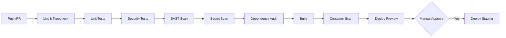

# CAC/PIV PKI Authentication — Public Reference Implementation

**Elliyeen LLC** | Forward Deployed Engineering | Cybersecurity & IAM Portfolio

[](https://github.com/elliyeen/cac-piv-pki-authentication/actions/workflows/ci.yml)
[](https://github.com/elliyeen/cac-piv-pki-authentication/actions/workflows/security.yml)
[](LICENSE)

---

## Overview

This repository demonstrates Elliyeen's capabilities in **FDE (Forward Deployed Engineering), Cybersecurity, IAM, PKI, Architecture, and DevSecOps** through a clean-room reference implementation of CAC/PIV (Common Access Card / Personal Identity Verification) authentication with X.509 certificate validation.

> **⚠️ Important:** This is a **sanitized, educational reference implementation** built from public standards only. It contains no customer data, real certificates, internal infrastructure details, or proprietary logic. All identities, certificates, and infrastructure are synthetic.

---

## Capabilities Demonstrated

| Domain | Demonstrated In |
|--------|-----------------|
| **PKI / X.509** | Certificate chain validation, trust anchor management, CRL/OCSP revocation checking |
| **CAC/PIV Authentication** | PIV-I certificate profile handling, EDIPI extraction, FASC-N parsing |
| **Identity & Access** | Dual authentication (cert + password), session management, account linking |
| **Architecture** | Zero-trust header-based identity propagation, trust boundary enforcement |
| **Security Testing** | Negative test suites, red-team scenarios, STRIDE threat modeling |
| **DevSecOps** | CI/CD with security gates (SAST, secret scan, dependency audit, container scan) |
| **Compliance** | NIST 800-53 control mapping, STIG-aligned session controls |

---

## Architecture (Generic)

```
┌─────────────┐     ┌─────────────┐     ┌─────────────┐     ┌─────────────┐
│   Client    │────▶│  VDI /      │────▶│    ALB      │────▶│  Application │
│  (CAC/PIV)  │     │  AppStream  │     │  (mTLS term)│     │  (Next.js)   │
└─────────────┘     └─────────────┘     └─────────────┘     └─────────────┘
                           │                    │                    │
                           │  Cert validation   │  Header injection  │  Header trust
                           │  CRL/OCSP check    │  x-edipi, x-cert-* │  validation
                           │  Revocation        │                    │  EDIPI extract
                           └────────────────────┴────────────────────┘
                                                          │
                                                          ▼
                                                 ┌─────────────┐
                                                 │  Database   │
                                                 │ (PostgreSQL)│
                                                 └─────────────┘
```

**Trust Boundary:** Certificate validation and revocation checking occur at the VDI/AppStream/ALB layer. The application **trusts validated headers only** after verifying they originate from the trusted ALB (via mTLS between ALB→App, source IP validation, or signed headers).

---

## Quick Start

### Prerequisites

- Node.js 20+ (LTS)
- pnpm 9+
- Docker (for local PostgreSQL)

### Installation

```bash
# Clone and install
git clone https://github.com/elliyeen/cac-piv-pki-authentication.git
cd cac-piv-pki-authentication
pnpm install

# Start local database
docker compose up -d postgres

# Generate synthetic test certificates
pnpm run certs:generate

# Run development server
pnpm dev
```

### Testing

```bash
# All tests with coverage
pnpm test:coverage

# Unit tests only
pnpm test:unit

# Security-focused tests (negative, red-team)
pnpm test:security

# Certificate validation tests
pnpm test:certs
```

---

## Repository Structure

```
.
├── docs/                 # Documentation
│   ├── ARCHITECTURE.md   # System architecture deep-dive
│   ├── THREAT_MODEL.md   # STRIDE threat model
│   ├── CONTROLS.md       # NIST 800-53 control mapping
│   ├── ADR/              # Architecture Decision Records
│   └── WALKTHROUGH.md    # 5-minute interview walkthrough
├── reference-impl/       # Clean-room Next.js + Better Auth implementation
│   ├── src/
│   │   ├── lib/cac/      # CAC middleware, header parsing, validation
│   │   ├── lib/certs/    # X.509 validation, CRL/OCSP client
│   │   ├── lib/auth/     # Better Auth integration, session management
│   │   └── app/          # Next.js App Router pages/api
│   ├── prisma/           # Database schema (sanitized)
│   └── package.json
├── test-fixtures/        # Synthetic certificates & test data
│   ├── certs/            # Generated PIV-I certs (valid, expired, revoked, malformed)
│   ├── crls/             # Synthetic CRLs
│   └── headers/          # Sample header payloads
├── diagrams/             # Architecture diagrams (SVG/Mermaid)
├── scripts/              # Operational scripts
│   ├── generate-certs.ts # Synthetic certificate generation
│   ├── fetch-crl.ts      # CRL fetching demo
│   └── validate-chain.ts # Chain validation demo
├── adr/                  # Architecture Decision Records
│   ├── 0001-header-based-auth.md
│   ├── 0002-crl-caching-strategy.md
│   ├── 0003-session-timeout.md
│   └── ...
├── .github/workflows/    # CI/CD pipelines
│   ├── ci.yml            # Lint, typecheck, test, build
│   ├── security.yml      # SAST, secret scan, dependency audit
│   └── deploy-preview.yml# Preview deployment
└── LICENSE
```

---

## Key Features

### Certificate Validation (`reference-impl/src/lib/certs/`)

- **Chain validation** — Root → Intermediate → Leaf with path length constraints
- **Trust anchor management** — Configurable root CA store (DISA PKI simulated)
- **CRL processing** — RFC 5280 compliant parsing, caching (24h TTL + stale-while-revalidate)
- **OCSP fallback** — Nonce support, response validation, caching
- **PIV-I profile validation** — Key usage, extended key usage, certificate policies

### CAC Middleware (`reference-impl/src/lib/cac/`)

- **Header trust validation** — Verify ALB source, mTLS validation, signature verification
- **EDIPI extraction** — From `x-edipi` header or Subject Alternative Name parsing
- **Certificate metadata parsing** — Subject DN, Issuer DN, serial, validity, thumbprint
- **Session enforcement** — 15-min sliding window, CSRF protection, secure cookies
- **Dual auth coordination** — CAC primary, password fallback for non-CAC accounts

### Security Testing (`reference-impl/src/__tests__/security/`)

| Test Suite | Scenarios |
|------------|-----------|
| **Negative Certificates** | Expired, not-yet-valid, revoked, self-signed, wrong EKU, path length exceeded |
| **Revocation** | Valid CRL, stale CRL, CRL unreachable (fail-closed), OCSP failure |
| **Header Spoofing** | Missing headers, forged EDIPI, mismatched cert/header, replay |
| **Session Attacks** | Fixation, hijacking, IDOR, timeout bypass, concurrent session limits |
| **Red Team (RT-01..RT-08)** | Mapped from delivery plan adversarial scenarios |

---

## Architecture Decision Records

| ADR | Title | Status |
|-----|-------|--------|
| [0001](adr/0001-header-based-auth.md) | Header-Based Identity Propagation vs In-App mTLS | ✅ Accepted |
| [0002](adr/0002-crl-caching-strategy.md) | CRL Caching: 24h TTL + Stale-While-Revalidate | ✅ Accepted |
| [0003](adr/0003-session-timeout.md) | 15-Minute Sliding Session Window (STIG V-259700) | ✅ Accepted |
| [0004](adr/0004-dual-auth-scoping.md) | Password Fallback Scoped to Non-CAC Accounts Only | ✅ Accepted |
| [0005](adr/0005-edipi-immutability.md) | EDIPI Immutable Once Bound to Account | ✅ Accepted |

---

## Compliance Mapping (NIST 800-53 Rev 5)

| Control | Implementation |
|---------|----------------|
| **IA-2** (Identification & Authentication) | CAC/PIV multi-factor via certificate + PIN |
| **IA-5** (Authenticator Management) | Certificate lifecycle, revocation checking, rotation |
| **SC-23** (Session Authenticity) | 15-min timeout, CSRF, secure flags, rotation |
| **AU-2/AU-3** (Audit Events/Content) | Structured auth audit logs with correlation IDs |
| **SC-12** (Cryptographic Key Establishment) | TLS 1.2+, certificate-based key exchange |
| **CM-7** (Least Functionality) | Minimal header surface, fail-closed defaults |

---

## CI/CD Pipeline



**Security Gates (all must pass):**
- ✅ Zero critical/high SAST findings
- ✅ Zero secrets detected
- ✅ Zero critical CVEs in dependencies
- ✅ Test coverage ≥ 80%
- ✅ All security tests pass

---

## 5-Minute Walkthrough

See [`docs/WALKTHROUGH.md`](docs/WALKTHROUGH.md) for a timed interview-ready walkthrough covering:
1. **Problem & Context** (30s)
2. **Architecture & Trust Boundaries** (60s)
3. **Certificate Validation Deep-Dive** (90s)
4. **Security Testing & Red Teaming** (60s)
5. **DevSecOps Pipeline** (30s)
6. **Compliance & ATO Readiness** (30s)

---

## Synthetic Certificate Generation

All test certificates are generated at build time using `scripts/generate-certs.ts`:

```bash
# Generates in test-fixtures/certs/
# - root-ca.pem           # Synthetic root CA
# - intermediate-ca.pem   # Synthetic intermediate
# - valid-piv.pem         # Valid PIV-I cert (EDIPI: 9999999999)
# - expired-piv.pem       # Expired cert
# - revoked-piv.pem       # Revoked cert (serial in test CRL)
# - malformed-*.pem       # Various negative cases
# - crl.pem               # Synthetic CRL with revoked serial
```

**No real certificates, keys, or PII are ever committed.**

---

## Contributing

This is a portfolio reference implementation. Issues/PRs welcome for:
- Bug fixes in reference implementation
- Additional test cases
- Documentation improvements
- Architecture discussion (via ADR proposals)

See [CONTRIBUTING.md](CONTRIBUTING.md) for guidelines.

---

## License

MIT License — See [LICENSE](LICENSE) for details.

---

## Contact

**Elliyeen LLC** — Forward Deployed Engineering  
🌐 https://elliyeen.com  
📧 engineering@elliyeen.com  

*This repository demonstrates capabilities for discussion purposes. Production deployments require customer-specific engineering, authorization, and ATO processes.*