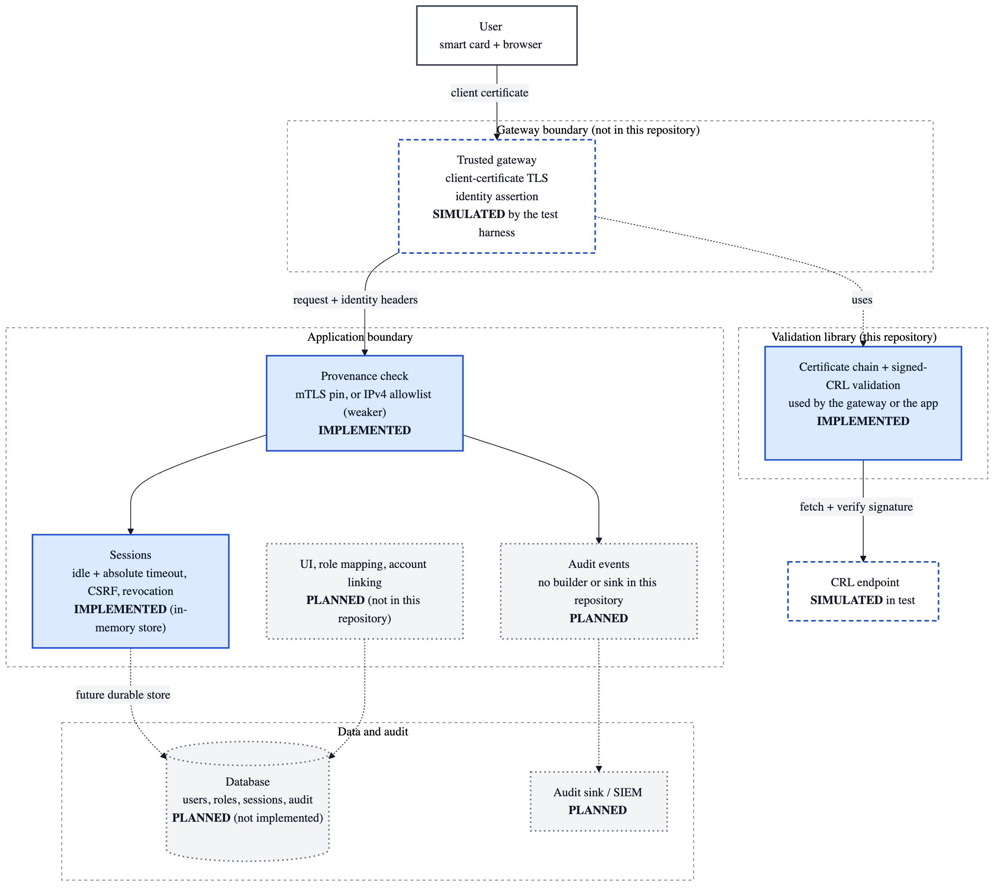
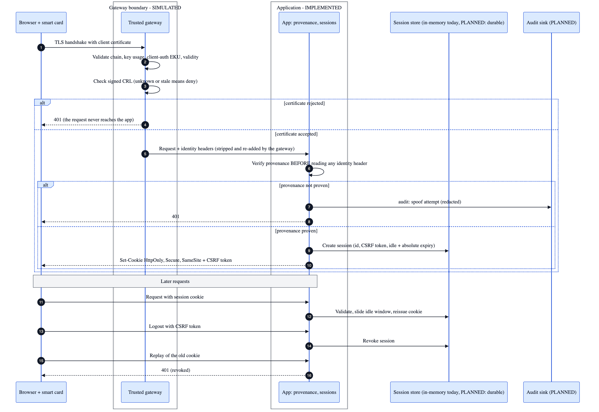
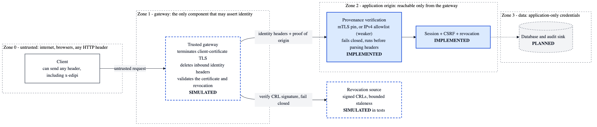
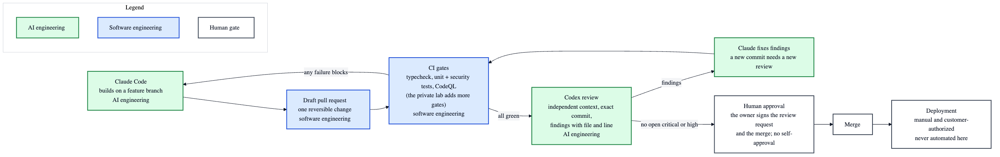

# Architecture

Four diagrams describe how the pieces of CAC/PIV authentication fit together and what **this repository** actually contains. Each node is labelled **IMPLEMENTED**, **SIMULATED** or **PLANNED**; color is only a second cue.

| Label | Meaning |
|---|---|
| **IMPLEMENTED** | Code in `reference-impl/` with passing tests (see [EVIDENCE](../../EVIDENCE.md)). |
| **SIMULATED** | Present only inside the offline test harness (loopback listener, generated PKI, injected CRL transport). Not a real gateway, load balancer or CA. |
| **PLANNED** | Not built in this repository. |

Colors: **blue** = software engineering, **green** = AI engineering, **neutral** = boundaries and human gates.

This is the public, educational reference. A separate private engineering lab exists; its code, configuration and results are not published and are not described here beyond what is stated in the [ROADMAP](../../ROADMAP.md).

## 1. System and data

The validation library is reusable at whichever boundary performs certificate validation (a gateway, or the application itself). Persistence and audit logging are not implemented here; sessions use an in-memory store. Source: [`01-system-and-data.mmd`](01-system-and-data.mmd) · [SVG](01-system-and-data.svg)

## 2. CAC login sequence

Order matters: provenance is verified **before** any identity header is read. A rejected certificate never reaches the application. Source: [`02-login-sequence.mmd`](02-login-sequence.mmd) · [SVG](02-login-sequence.svg)

## 3. Security trust boundaries

Source: [`03-trust-boundaries.mmd`](03-trust-boundaries.mmd) · [SVG](03-trust-boundaries.svg)

| Threat | Control that answers it | Status |
|---|---|---|
| Forged identity header (for example `x-edipi`) | Origin proof required before headers are parsed | IMPLEMENTED (mTLS pin; IPv4 allowlist is a weaker mode) |
| Direct request to the application origin | Provenance fails closed | IMPLEMENTED |
| Revoked, expired, forged or wrong-purpose certificate | Chain, validity, key-usage/EKU and signed-CRL checks | IMPLEMENTED |
| Unknown or stale revocation data | Deny, never allow | IMPLEMENTED |
| Stolen or replayed session cookie | Server-side revocation, idle and absolute timeout, CSRF token | IMPLEMENTED (in-memory store) |
| Gateway that signs the identity it asserts | Authenticated assertion instead of network position | PLANNED |

## 4. Delivery workflow

Claude builds, CI gates, Codex reviews the exact commit independently, a human approves; deployment is never automated by this process. A new commit after a review needs a new review. Source: [`04-delivery-workflow.mmd`](04-delivery-workflow.mmd) · [SVG](04-delivery-workflow.svg)

CI in this repository today: typecheck, unit, security and certificate tests, the offline demo, and CodeQL. (No secret scanning, container scanning or dependency audit is configured here; see the README.) The independent-review and approval steps are a development process, not something this repository enforces; branch protection and required reviews are repository settings.

## Regenerating

The `.mmd` files are the source. With [mermaid-cli](https://github.com/mermaid-js/mermaid-cli): `mmdc -i NAME.mmd -o NAME.png -b white -w 1400 -s 2` (and `-o NAME.svg`).
